# Лаба 2. Мониторинг FastAPI

## Часть 0. Сервис

Мы развернули HTTP-сервис на FastAPI. Для проверки мониторинга предусмотрели
четыре эндпоинта: `/health`, `/load`, `/fail` и `/slow`. Сервис отдает метрики
на `/metrics`, пишет JSON-логи с `trace_id` и отправляет трейсы через OpenTelemetry.

Образ `lab2-api:1.0` собрали по Dockerfile и загрузили в kind. В кластере
`kind-labs` запустили две реплики API в namespace `labs`. Остальные компоненты
разместили в `default` и `monitoring`. API, Prometheus, Grafana, Loki, Alloy,
Jaeger, Karma и приемник уведомлений установлены через Helm.

### Headlamp

Для просмотра ресурсов и локального доступа использовали Headlamp.
В нем проверяли Services, связанные поды и порты, открывали port-forward
для API, Prometheus, Grafana и приемника алертов.

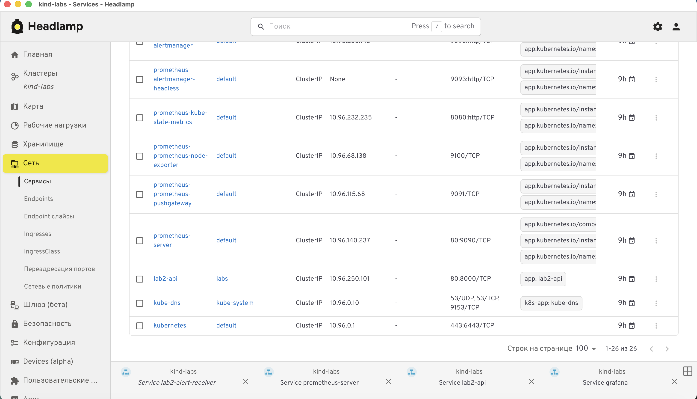

*Сервисы стенда в Headlamp. Здесь же открывали port-forward к компонентам.*

У Service `lab2-api` порт 80 направлен на порт 8000 контейнера. На скриншоте
показан проброс на локальный порт 8000; в `forward_stack.py` используется
18080. Снимки сделаны до последнего rollout, поэтому имена подов отличаются
от текущих.

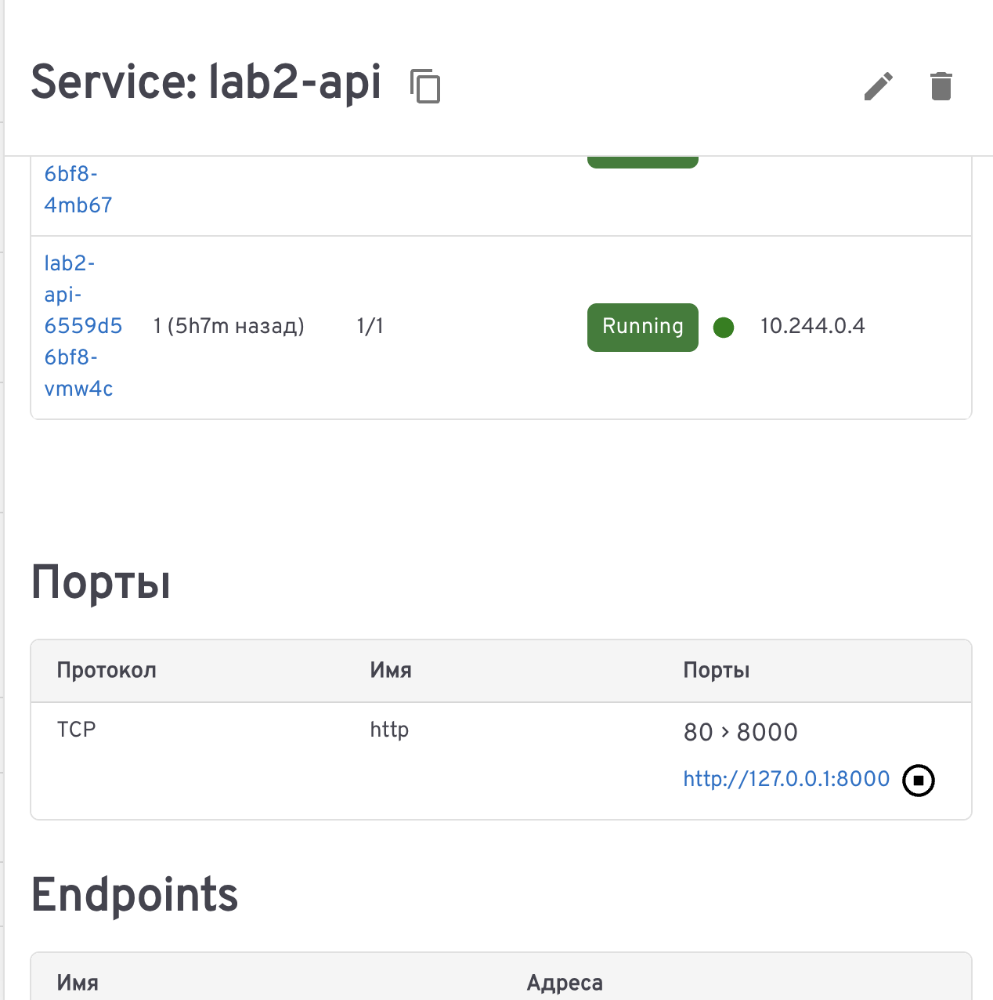

*Карточка `lab2-api`: поды за Service и проброс порта 80 → 8000.*

## Часть 1. Метрики

Сбор метрик настроили через annotations Service. Prometheus обнаруживает
обе реплики API и опрашивает `/metrics` каждой из них раз в минуту.
Обе цели находятся в состоянии UP.

В Grafana добавили Prometheus и создали RED-дашборд:

- RPS по всему сервису;
- процент ответов 5xx;
- p95 времени ответа.

При первой проверке RPS отображался как `No data`. Интервал сбора в Prometheus
составлял минуту, а Grafana рассчитывала `$__rate_interval` исходя из 15 секунд.
После настройки `1m` в источнике данных окно стало содержать достаточно точек
для `rate()`.

Проверили реакцию графиков: `/load` увеличивал число запросов в секунду,
`/fail` повышал долю 5xx, `/slow` увеличивал p95 примерно до 2,4 с.

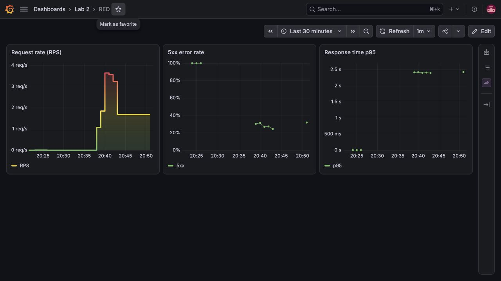

*RED-дашборд под тестовой нагрузкой: RPS, доля 5xx и p95 времени ответа.*

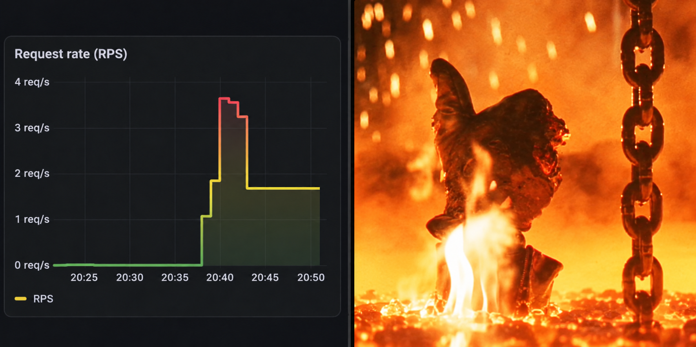

*Когда нагрузочный тест получил одобрение самого графика.*

В контрольном прогоне за 210 секунд выполнили 630 запросов, по 210
на `/health`, `/fail` и `/slow`. Транспортных повторов не было, p95 составил
2,421 с. Значение рассчитано по бакетам гистограммы; длительность отдельного
медленного запроса проверили в Jaeger.

Для суммарных метрик сначала применяем `rate()` к каждой серии, затем
агрегируем реплики. При вычислении p95 сохраняем метку `le` с границами бакетов.

## Часть 2. Логи

Для хранения логов установили Loki, для сбора stdout подов настроили Alloy.
Он работает как DaemonSet и через field selector `spec.nodeName` выбирает
поды своего узла. Записи читает через Kubernetes API и отправляет в Loki.

Loki подключили к Grafana. После вызова `/fail` нашли запись об HTTP 500
в Explore:

```logql
{namespace="labs",container="lab2-api"}
| json
| __error__=""
| route="/fail"
| status="500"
```

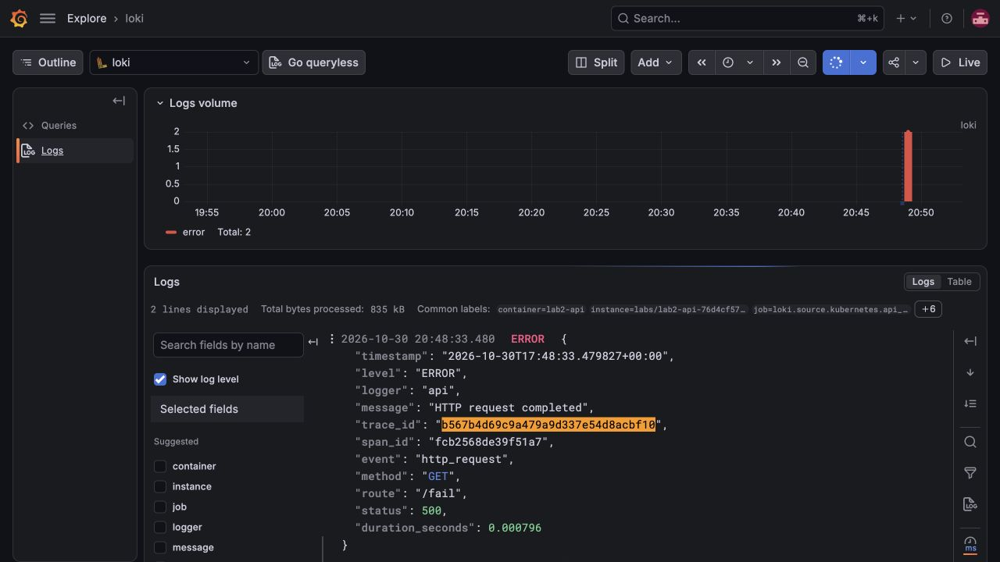

*Запрос `/fail` в Loki: HTTP 500, длительность и `trace_id` для перехода к трейсу.*

В записи есть маршрут, статус, длительность и `trace_id`. Последний оставили
полем JSON: уникальная индексируемая метка на каждый запрос увеличивала бы
кардинальность потоков Loki.

## Часть 3. Трейсы

Установили Jaeger 2.22 и настроили экспорт из API по OTLP/HTTP на порт 4318.
Jaeger добавили в Grafana как отдельный источник данных.

**`/slow`.** Серверный спан создается инструментацией FastAPI автоматически.
Операция ожидания выполняется внутри дочернего спана `slow-op`. В сохраненном
трейсе он занимает 2,001 с, почти всю длительность запроса.

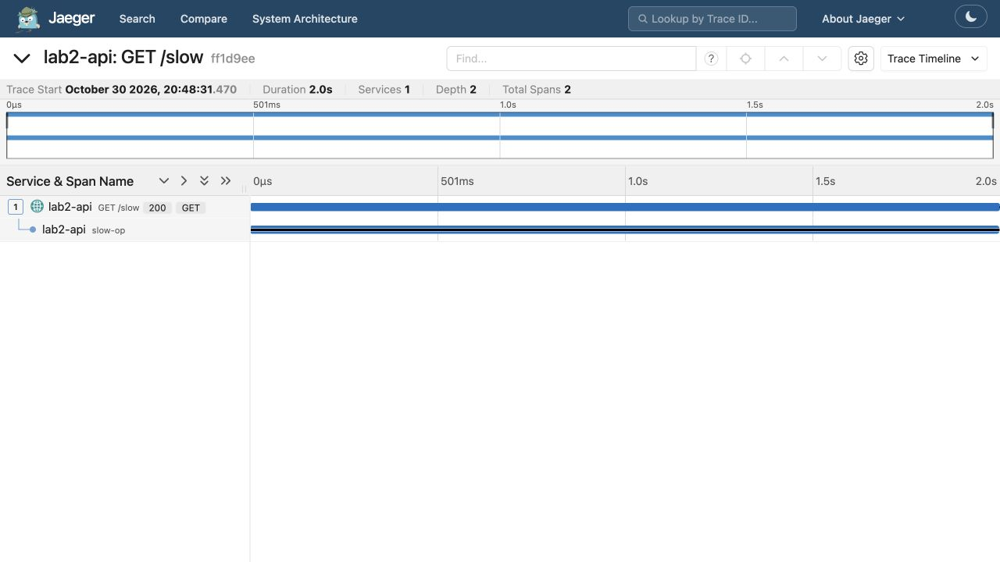

*Водопад `/slow` в Jaeger. Почти все время запроса занимает дочерний спан `slow-op`.*

**`/fail`.** Спан содержит HTTP 500 и отмечен атрибутами
`otel.status_code=ERROR`, `error=true`.

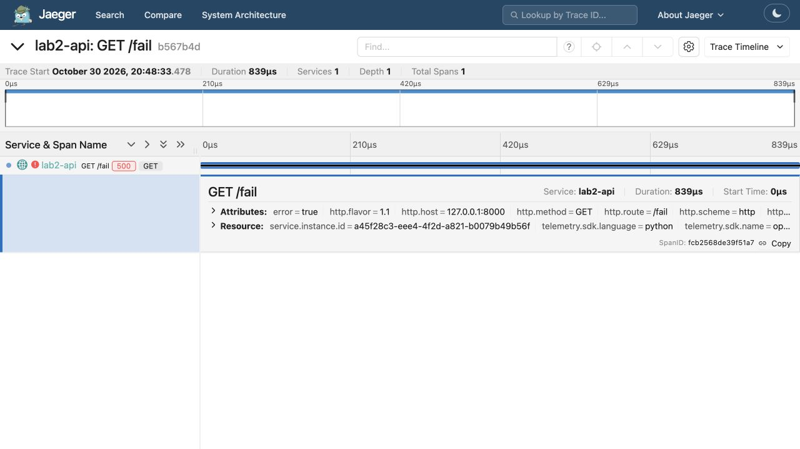

*Трейс `/fail`: ответ HTTP 500 и отметка об ошибке на спане.*

**Связь с логами.** Из записи Loki взяли `trace_id`
`b567b4d69c9a479a9d337e54d8acbf10` и открыли трейс через derived field
в Grafana. Совпали ID запроса, маршрут `/fail` и статус ошибки.

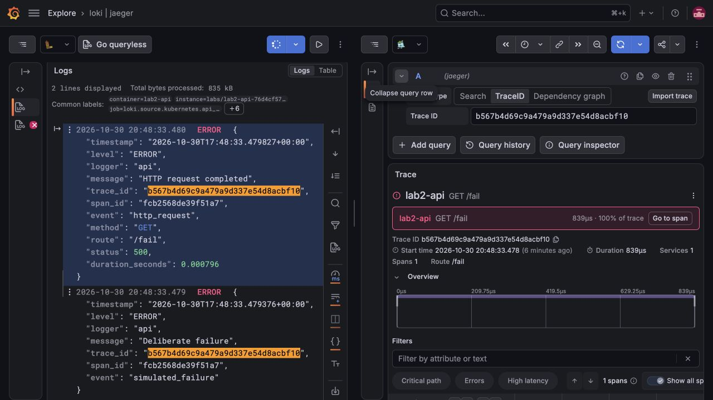

*Один запрос в двух источниках: запись Loki и связанный с ней трейс Jaeger.*

## Часть 4. Алерты

В Prometheus настроили три критических правила. Alertmanager получает
срабатывания и направляет их получателю `lab2-webhook`. Это сервис внутри
кластера, который сохраняет последние уведомления на `/events` и выводит
их в JSON-лог. Для просмотра активных алертов установили Karma.

| Алерт | Условие | Почему важен | Действия дежурного |
| --- | --- | --- | --- |
| `Lab2High5xxRate` | Доля 5xx превышает 5% | Операции пользователей завершаются ошибками | Проверить ERROR-логи и трейсы, определить проблемный маршрут или зависимость, проверить последний релиз |
| `Lab2HighP95` | p95 превышает 1 с | Время ответа выходит за выбранный порог | Найти долгие трейсы и медленный спан, проверить ресурсы и внешние вызовы |
| `Lab2ApiUnavailable` | Все цели сбора метрик API недоступны либо отсутствуют | Возможна полная недоступность сервиса | Проверить реплики, endpoints и события, восстановить доступную реплику |

Для всех правил задано `for: 1m`. Доля ошибок и p95 вычисляются за окно
пять минут при наличии минимум 20 запросов. Пороги выбраны для лабораторного
стенда; в рабочем сервисе их следует определять по SLO.

**`Lab2High5xxRate` и `Lab2HighP95`.** Для проверки подавали смешанный трафик
на `/health`, `/fail` и `/slow`. Оба правила перешли в firing и появились в Karma.

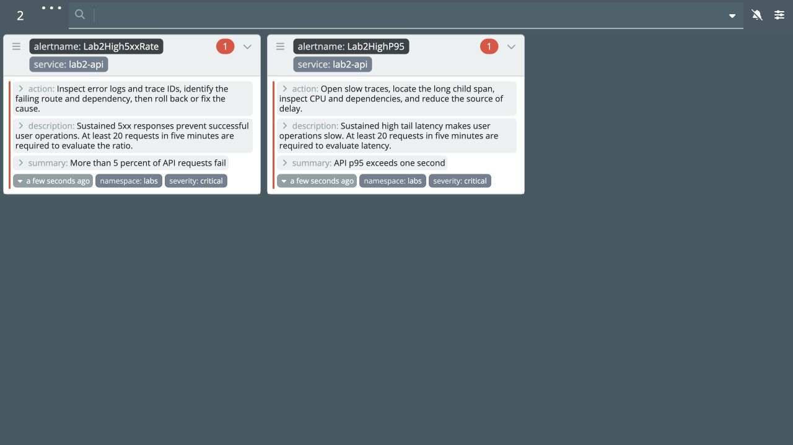

*Karma после нагрузочного прогона: сработали правила на долю ошибок и p95.*

**`Lab2ApiUnavailable`.** Масштабировали API до нуля. Алерт перешел в firing
примерно через 150 секунд с учетом обновления targets, staleness и выдержки
правила. При первоначальной проверке таймаут ожидания был слишком коротким;
после его увеличения срабатывание подтвердили.

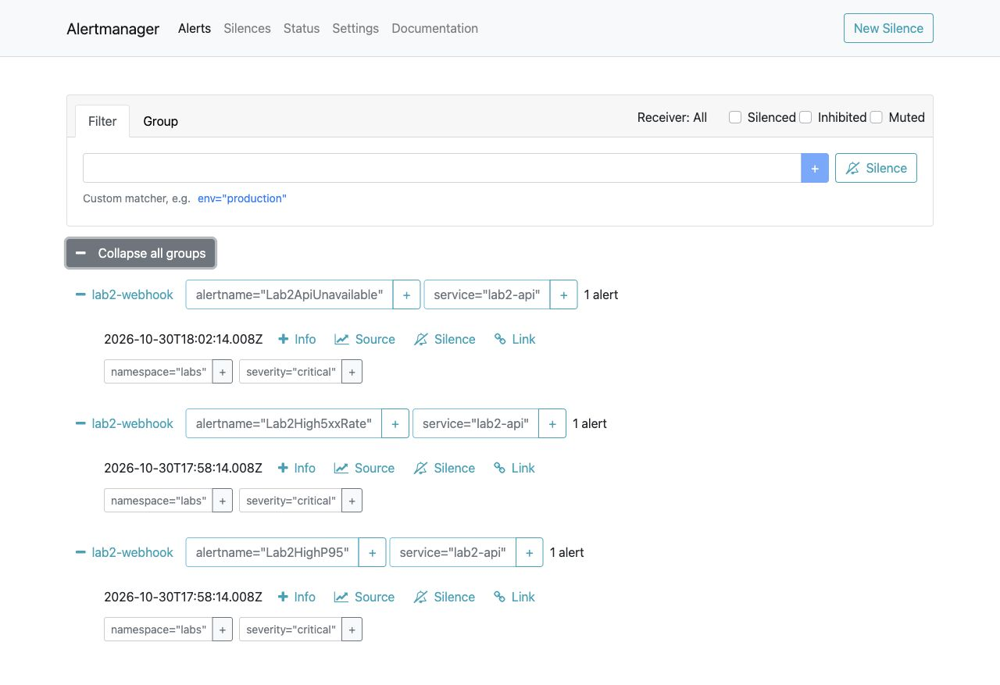

*Три срабатывания в Alertmanager, направленные получателю `lab2-webhook`.*

Все три срабатывания также отображаются в Karma:

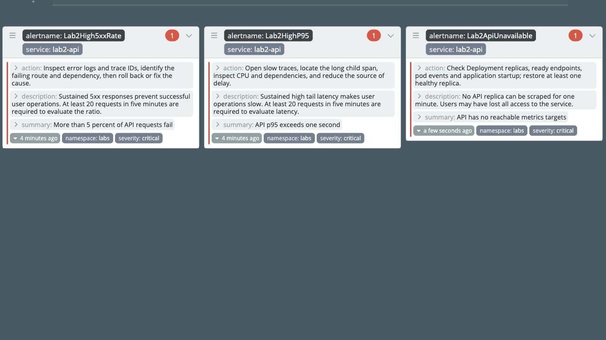

*После остановки API в Karma появился и алерт о недоступности сервиса.*

В журнале receiver подтвердили получение `firing` от каждого правила.
После восстановления двух реплик Prometheus снова показал `up=1`, пришли
уведомления `resolved`, а правила вернулись в `inactive`.

## Итог

Мы настроили сбор метрик, логов и трейсов API, связали записи Loki с Jaeger
по `trace_id` и проверили доставку трех критических алертов. После экспериментов
обе реплики API работают, активных алертов нет.

Helm charts, правила и настройки Grafana находятся в `helm/`, values для Loki
и Alloy в `api/`, JSON дашбордов в `helm/dashboards/`.
Jaeger и receiver хранят историю в памяти, Loki использует временный том.
