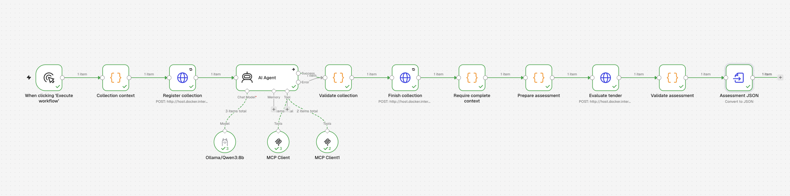
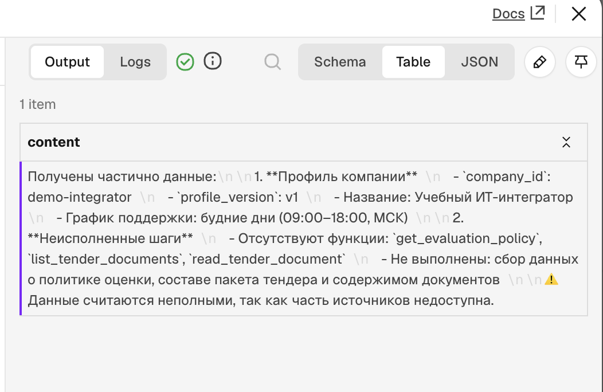
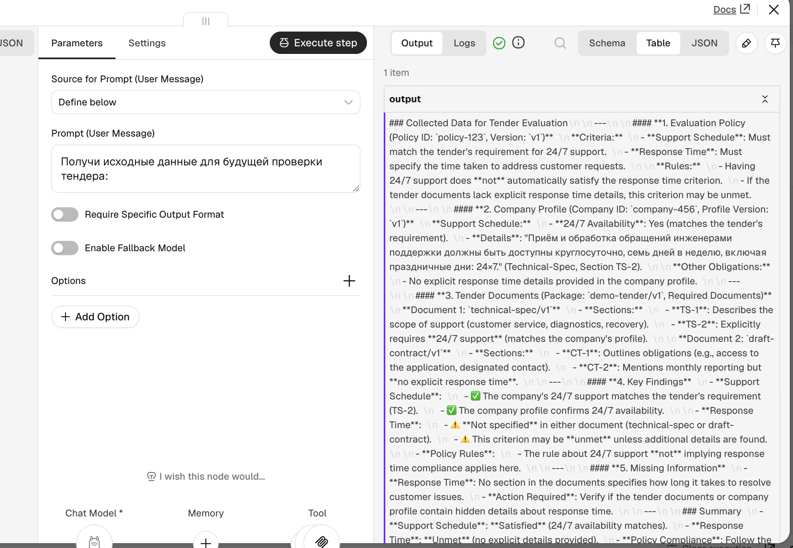
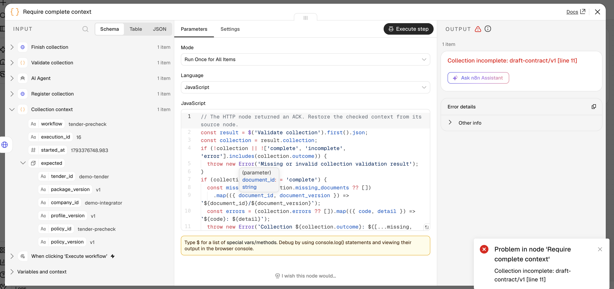
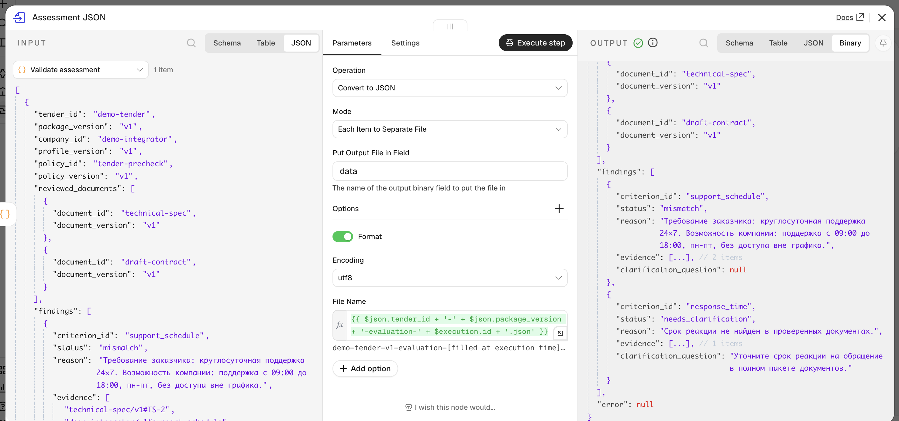
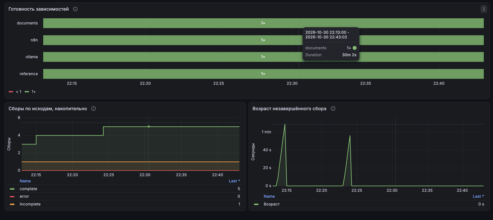

# Лаба 8. Оценка тендерной документации с LLM

## Часть 1. Кейс

Для лабы придумали ИТ-интегратора, который участвует в тендерах на сопровождение систем. Перед подачей заявки менеджер и руководитель поддержки читают ТЗ, проект договора и сверяют требования с возможностями компании. Условия разбросаны по файлам: график поддержки может быть в ТЗ, а сроки реакции в договоре.

Мы автоматизировали предварительный разбор: собрать пакет, найти расхождения и подготовить вопросы заказчику. Например, заказчику нужны инженеры 24×7, а поддержка компании работает только по будням. Система показывает это менеджеру, решение об участии остаётся за людьми.

## Часть 2. Что собрали

Использовали n8n 2.45.6 в Docker и локальную `qwen3:8b` через Ollama. Вместо настоящего Nextcloud подготовили тестовые ТЗ и договор. Вспомогательные сервисы и тестовые данные сделали с помощью ИИ.

**Цепочка:** ручной запуск → агент собирает источники через MCP → код проверяет полноту → модель оценивает требования → код проверяет JSON и ссылки → создаётся файл результата.



Два MCP-сервера дают агенту четыре инструмента только для чтения:

| Сервер | Инструмент | Что делает | Вход |
|---|---|---|---|
| Документы, порт 8001 | `list_tender_documents` | Получает состав пакета | `tender_id, package_version` |
| Документы, порт 8001 | `read_tender_document` | Читает текст и разделы | `document_id, document_version` |
| Справочники, порт 8002 | `get_company_profile` | Получает возможности компании | `company_id, profile_version` |
| Справочники, порт 8002 | `get_evaluation_policy` | Получает критерии проверки | `policy_id, policy_version` |

В skills описали порядок и правила: сначала получить политику, профиль и список пакета, затем прочитать все обязательные документы. Каждый вывод нужно подтвердить источниками. Если данных не хватает, ставим `needs_clarification` и задаём вопрос заказчику.

Сбор и оценку разделили. Агент работает с MCP, отдельный AI-шаг получает проверенные тексты. Полноту проверяет Code node по фактическим ответам инструментов. Самого сообщения модели «всё прочитано» недостаточно.

## Часть 3. Запуск и результаты

<details>
<summary>Как запустить локально</summary>

Нужны Docker Desktop, Ollama, Python 3.13 и uv. Для мониторинга используем Prometheus и Grafana из второй лабы в кластере `kind-labs`, namespace `default`.

Запускаем Ollama и загружаем модель:

```sh
ollama pull qwen3:8b
```

Создаём n8n с образом нашего стенда:

```sh
docker run -d --name n8n \
  -p 127.0.0.1:5678:5678 \
  -v n8n_data:/home/node/.n8n \
  n8nio/n8n@sha256:45edf89655fd66dd55ea9336c1791ad14777599fdbf6c5aec6db583ede99a40b
```

Если контейнер уже создан, достаточно `docker start n8n`.

Из корня репозитория устанавливаем зависимости сервисов:

```sh
cd lecture-8-ai/tender-review/mcp-services
uv sync --frozen
```

Следующие команды выполняем по отдельности в трёх терминалах, каждый из папки `mcp-services`:

```sh
uv run --frozen python -m tender_mcp documents --data-root ../fixtures/tenders --allow-host host.docker.internal:8001
uv run --frozen python -m tender_mcp reference --data-root ../fixtures/reference --allow-host host.docker.internal:8002
uv run --frozen python -m tender_mcp.metrics
```

</details>

**Проблемы при настройке**

Сначала MCP возвращал `421 Invalid Host header`. Запрос доходил до сервера, но SDK отклонял `host.docker.internal`. Разрешили конкретный Host с нужным портом через `--allow-host`.

Затем агент заявил, что части инструментов нет. Мы указали названия в prompt, но не выбрали сами инструменты в MCP Client.



`Message a Model` возвращал пустой ответ при последовательном чтении, поэтому перешли на AI Agent. В другом запуске модель перепутала заказчика и компанию: приписала ей поддержку 24×7 и выдумала идентификаторы. В логах нашли обрезание контекста и увеличили окно с 4096 до 16384.



Агент пропустил договор и объяснил это ошибкой сервера. В истории MCP вызова чтения вообще не было. Проверка обнаружила пропуск, зарегистрировала `incomplete` и остановила workflow.



**Полный успешный запуск**

В запуске № 21 вся цепочка выполнилась за **84,5 секунды**. Агент сделал пять успешных вызовов MCP: получил политику, профиль, список пакета и прочитал оба документа. Затем модель сформировала оценку, валидатор её пропустил, а последний узел создал json.



| Критерий | Вывод модели | Основание |
|---|---|---|
| График поддержки | `mismatch` | Заказчику нужно 24×7, компания работает по будням 09:00–18:00 |
| Срок реакции | `needs_clarification` | В проверенных документах срок не указан, нужно уточнить у заказчика |

Точную копию созданного файла сохранили в [reports/evaluation-demo-tender-v1.json](reports/evaluation-demo-tender-v1.json). Выводы сверили с исходниками. Эталонные статусы модели не передавали.

## Часть 4. Мониторинг

Переиспользовали Prometheus и Grafana из второй лабы. Exporter раз в 15 секунд проверяет два MCP, n8n и наличие модели в Ollama. Генерацию для проверки доступности не запускаем.



На графиках видны два завершённых сбора: `complete` вырос с 3 до 5, возраст после каждого вернулся к нулю. Все четыре зависимости доступны, неполных сборов накопилось 1, технических ошибок 0.

Для алертов выбрали:

| Метрика | Условие | Что ловим |
|---|---|---|
| `tender_dependency_ready{component}` | 0 в течение минуты | Недоступен MCP, n8n или Ollama |
| `tender_collection_runs_total{outcome}` | Прирост `incomplete` или `error` за 30 минут | Ошибка или неполный пакет при доступных сервисах |
| `tender_collection_oldest_running_age_seconds` | Больше 180 секунд в течение минуты | Зависший сбор или недоставленное завершение |

180 секунд взяли с запасом относительно измеренных запусков. События храним в SQLite по ключу `workflow + execution_id`: повтор завершения не увеличил счётчик.

Эти метрики относятся к сбору источников. Его `complete` ещё не подтверждает успешную оценку. Счётчики накопительные, отсутствие метрик означает неизвестное состояние. Для лабы выбрали условия алертов; сами уведомления не настраивали.

